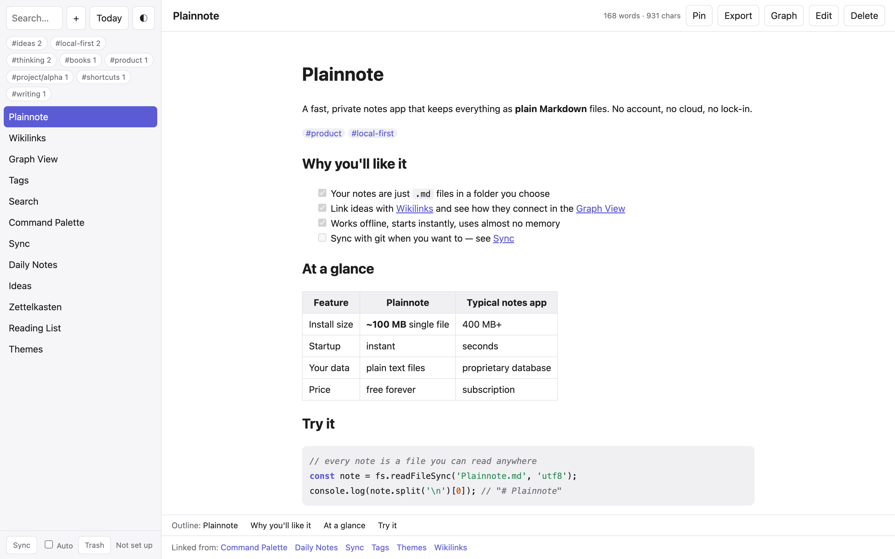

<p align="center"></p>

# Plainnote

[](https://github.com/zyvorai/note/actions/workflows/test.yml)
[](https://github.com/zyvorai/note/releases/latest)
[](LICENSE)


**[Website](https://zyvorai.github.io/note/) · [Download](https://github.com/zyvorai/note/releases/latest) · [Contributing](CONTRIBUTING.md)**

<p align="center"></p>

A free, lightweight, local-first notes app. Your notes are plain Markdown files in a folder you choose. No dependencies, no build step, no accounts, no telemetry: just Node.js.

## Run

```sh
node server.js [notesDir] [port]
# e.g.
node server.js ~/Notes          # http://localhost:4777
```

`notesDir` defaults to `./notes` and `port` to `4777` (or `$PORT`). Requires Node.js 20+. You can point it at an existing Obsidian vault or any folder of `.md` files.

## Desktop app (macOS)

```sh
./desktop/build.sh      # builds dist/Plainnote.app (needs Xcode command line tools)
open dist/Plainnote.app
```

A native wrapper (Swift + WKWebView, no Electron), universal for Apple Silicon and Intel. It has a translucent sidebar and full-size window, a real menu bar, a Dock menu and a menu-bar icon, and integrates with macOS:

- **Quick capture**: press **Ctrl+Option+N** anywhere to jot a line into today's daily note without leaving what you're doing (⌘↩ saves, esc cancels).
- **`plainnote://` links**: `plainnote://open/<note>`, `plainnote://today`, `plainnote://new?title=…&text=…`.
- **Open files and folders**: open a `.md` file from Finder, or drop a folder on the Dock icon to use it as your notes folder.
- **Services**: select text in any app, then *Services ▸ New Plainnote from Selection*.
- **Share** the open note from the File menu, and sync notifications when the app is in the background.

A tiny native wrapper (Swift + WKWebView, no Electron). It starts the bundled server on a free local port, shows it in a window, and stops it on quit. Node.js must be installed. **File → Choose Notes Folder…** switches folders (default `~/Notes`). Local builds are ad-hoc signed. For distribution, build with `SIGN_ID="Developer ID Application: …" ./desktop/build.sh` (hardened runtime), then sign the DMG and run `xcrun notarytool submit <dmg> --key AuthKey.p8 --key-id … --issuer … --wait` and `xcrun stapler staple <dmg>`. CI does all of this on tagged releases when these repository secrets are set: `MACOS_CERT_P12` (base64 .p12), `MACOS_CERT_PASSWORD`, `MACOS_SIGN_ID`, `NOTARY_KEY_P8` (base64 App Store Connect API key), `NOTARY_KEY_ID`, `NOTARY_ISSUER_ID`. Without them it produces an unsigned-for-distribution DMG. To release without storing the certificate in GitHub, run `./scripts/release.sh <version>` on a Mac that has the Developer ID identity and a `notary` notarytool profile: it tags, builds, signs, notarizes, staples and publishes the release (CI supplies the Linux and Windows binaries).

## Desktop app (Windows and Linux)

A single downloadable executable, no Node install needed. Build it on the target OS:

```sh
node scripts/build-sea.js      # -> dist/plainnote-<platform>-<arch>[.exe]
```

CI builds all three platforms: run the **build-desktop** workflow, or push a `v*` tag to attach the executables to a GitHub release (the macOS build also attaches a universal `Plainnote-<version>-universal.dmg`).

It starts the notes server on `127.0.0.1` and opens it in a standalone app window using an installed Chrome, Edge, Chromium or Brave (Edge ships with Windows), falling back to your default browser. Closing the window quits the app. Launching it again opens another window on the running instance.

```sh
plainnote                      # notes in ~/Notes
plainnote --notes D:\Notes     # or set PLAINNOTE_DIR
plainnote --no-window          # server only, open the printed URL yourself
```

`PLAINNOTE_BROWSER` points at a specific browser. On Linux, `desktop/linux/plainnote.desktop` is a starter launcher entry. Without Node installed you can also run the launcher directly with `node desktop/launcher.js`. On Windows a console window stays open while the app runs; the executable is unsigned, so SmartScreen may warn on first run.

## Features

- **Markdown files on disk**: subfolders work (`folder/name`); anything that reads Markdown can open them.
- **Wikilinks** `[[Note]]` / `[[Note|alias]]` with autocomplete as you type `[[`. Links to missing notes are created on click. Renaming a note updates links to it.
- **Backlinks** for every note, and a **graph view** (drag, pan, zoom, click to open).
- **Tags**: `#tag` or `#parent/child`, filter from the sidebar.
- **Full-text search** with snippets, and a **quick switcher**. The sidebar search understands `"exact phrase"`, `tag:idea`, `path:work/`, `file:plan`, `-excluded`, and `/regex/`; **save** a search as a chip.
- **Smarter links**: `[[Note#Heading]]` and `[[Note^block]]` (end a line with ` ^id`) jump to the spot, frontmatter `aliases:` resolve to the note, `[[Note#` autocompletes headings, hovering a link previews the note, and each note lists the notes it links to as well as its backlinks.
- **Preview** with tables, images (remote or from your folder), task lists and syntax-highlighted code blocks.
- **Live syntax highlighting while you edit** (headings, bold, links, wikilinks, tags, code blocks with per-language colours).
- **Slash menu**: type `/` at the start of a line for headings, tasks, tables, code blocks, dividers, links and today's date.
- **Writing tools**: note templates (`templates/` folder, `{{date}}` `{{title}}`), find and replace (Ctrl/Cmd+F), focus mode (Ctrl/Cmd+Shift+F).
- **Knowledge tools**: `> [!tip]` callouts, `==highlights==`, footnotes, `![[Note]]` / `![[Note#Heading]]` embeds, YAML frontmatter (`tags:` count as tags), unlinked mentions with one-click linking, and an all-notes open-tasks view (command palette).
- **Editor niceties**: list continuation, Tab/Shift+Tab indent, Cmd/Ctrl+B and +I, paste or drop images (saved to `attachments/`).
- **Safe by default**: autosave, deletes go to `.trash/` (restore from the Trash button), and if a note changes on disk underneath you (sync, another window) your version is saved as a "conflict" copy instead of overwriting.
- **Git sync**, manual or every 2 minutes.
- Light, dark or follow-the-system theme (toggle at the top of the sidebar, remembered), and a narrow-screen layout.

## Shortcuts

| Key | Action |
|---|---|
| Ctrl/Cmd+K | Quick switcher (jump or create) |
| Ctrl/Cmd+Shift+P | Command palette (every action, searchable) |
| Ctrl/Cmd+N | New note |
| Ctrl/Cmd+E | Toggle edit / preview |
| Ctrl/Cmd+G | Toggle graph view |
| Ctrl/Cmd+S | Save now |
| Ctrl/Cmd + / - / 0 | Larger / smaller / reset text size |
| Ctrl/Cmd+[ / ] | Back / forward through opened notes |
| Ctrl/Cmd+Shift+T | Open today's daily note (`daily/YYYY-MM-DD`) |
| Ctrl/Cmd+Shift+L | Cycle theme (auto / light / dark) |
| Ctrl/Cmd+F | Find and replace in the note |
| Ctrl/Cmd+Shift+F | Focus mode |
| Ctrl/Cmd+B / I | Bold / italic |
| Tab / Shift+Tab | Indent / outdent |

## Sync

The notes folder is just files, so sync uses git:

1. Create an empty **private** repo on your git host.
2. Click **Sync** (bottom of the sidebar) and enter the remote URL (`https://…`, `ssh://…` or `git@host:user/repo.git`).
3. Each sync commits changes, pulls with rebase, and pushes. On a conflict the rebase is aborted and an error is shown; nothing is lost locally.
4. Tick **Auto** to sync every 2 minutes while the tab is visible.

Authentication is whatever git already uses on your machine (SSH keys, credential helper). Prefer iCloud, Dropbox or Syncthing? Point the app at a folder inside one and ignore the Sync button.

## Security

- Listens on `127.0.0.1` only and rejects requests whose `Host` isn't localhost (DNS-rebinding) or whose `Origin` is another site.
- Note paths are confined to the notes folder; only image files are served from it, SVGs sandboxed.
- Sync remotes are limited to `https://`, `ssh://` and `git@host:path` URLs.
- There is no authentication: anyone with access to your local machine's port can read your notes. Don't expose the port.

## Development

```sh
npm test        # node --test: markdown/editor unit tests, server API tests, and a headless-Chrome UI test
```

The UI test drives the real app through the Chrome DevTools protocol (no dependencies) and is skipped if Chrome isn't installed. `UI_SHOTS=dir npm test` saves screenshots.

```
server.js          zero-dependency HTTP server + file/git API
public/index.html  the page shell; public/app.css and public/app.js hold the UI
public/md.js       Markdown renderer and editor helpers (shared with the tests)
desktop/           macOS wrapper (Plainnote.swift, build.sh), cross-platform launcher.js, Linux .desktop
scripts/build-sea.js  builds the single-file executable
tests/             unit, API and browser tests
docs/              the website (GitHub Pages) and its screenshots
```

## Limits

The editor is a plain textarea, not a full code editor. The graph layout is O(n²): fine for a few hundred notes. The Windows/Linux builds are produced by CI and haven't been tested by hand on those systems; the macOS wrapper needs Node installed. No encryption at rest and no built-in auth (it relies on being local-only).

## Contributing

Issues and pull requests are welcome: see [CONTRIBUTING.md](CONTRIBUTING.md) and the [Code of Conduct](CODE_OF_CONDUCT.md). Report security problems privately ([SECURITY.md](SECURITY.md)).

## License

MIT
